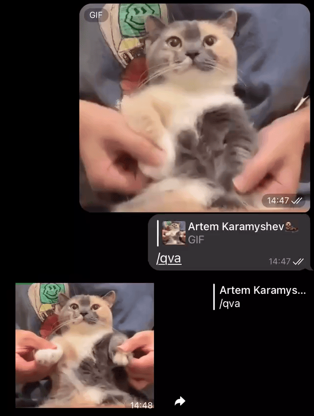

# [Mallard](https://t.me/cryakwa_bot)
It quacks, quotes video captures and creates stickers.
# Features
## Stickers
Mallard can turn video captures, gifs, video files and images into stickers.

Use `/qva` for video stickers and `/snap` for static ones.

Use `/emoji` replying to sticker to convert into emoji (quick reaction) compatible format.

You can also use following parameters with `/qva`:
* `s<sec>` will crop video starting from `sec`, `sec` should be integer
* `e<sec>` will crop video to `sec`, `sec` should be integer
* `x<speed>` will change video speed to `speed`, `speed` can be provided in format: 123.123
* `r` — will invert video if present
* `b<id>` — adds speach bubble, 1 — right, 2 — up
* `j` — if provided converts video into emoji (quick reaction) compatible format.
* For example `/qva s5 e7 x2.5 r` will crop video from 00:05—00:07, invert it and speed it up by two times.

Two add sticker to your sticker pack use [stickerpack creation bot](https://t.me/fStikBot).



## Development

Python 3.14, Python libraries, FFmpeg, and ffprobe come from nixpkgs, pinned by
the root repository's `flake.lock`. The same dependency definition supplies the
development shell and the Linux container. Pytest is only in the development shell.

From the repository root:

```bash
set -euo pipefail
nix develop .#mallard-bot
cd projects/mallard-bot
python -m pytest tests.py -q
# Set TG_API_KEY and TG_ADMIN_ID before starting the bot.
python app.py
```

Build the container on Linux (or with an appropriate remote Nix builder), from
the repository root:

```bash
set -euo pipefail
nix build .#mallard-bot-image
podman load --input result
image_name=$(nix eval --raw .#mallard-bot-image.imageName)
image_tag=$(nix eval --raw .#mallard-bot-image.imageTag)
podman run --rm --env TG_API_KEY --env TG_ADMIN_ID \
  --volume "$PWD/projects/mallard-bot/voices:/app/voices" "$image_name:$image_tag"
```

The image is built with `dockerTools`, without a distribution base image or
runtime package installation. The root Mallard workflow runs the regression
suite with Nix dependencies and smoke-tests the production image as UID/GID 805.
Quote pixel baselines use the rendering libraries from the pinned nixpkgs input.

The NAS loads its Nix-built image before Compose starts. Its generated image tag
changes with the build inputs; registry pulls and weekly image updates are disabled
for this service. Updating the flake and deploying the NAS updates the image.

Runtime settings remain `TG_API_KEY` and `TG_ADMIN_ID`, with voice files stored
in `voices/`. Text quote rendering still expects `fonts/JMH Typewriter-Bold.otf`;
that font is not included in the vendored sources. Rendering tests use Pillow's
bundled test font without changing the runtime font lookup.
